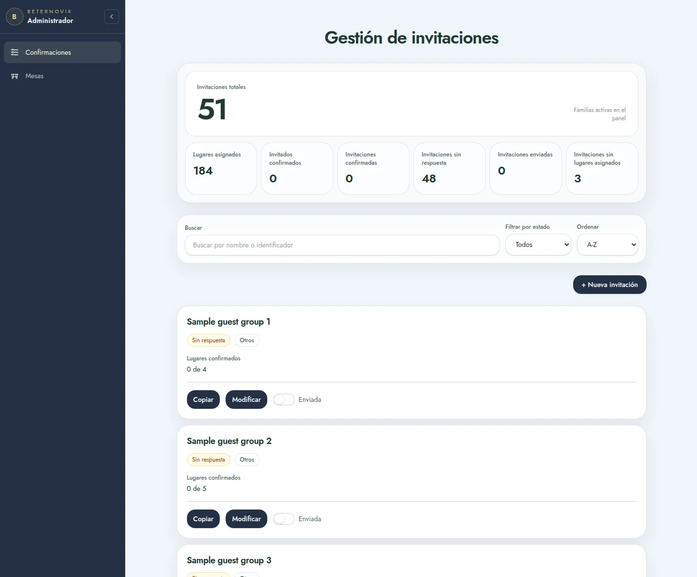

# Invitations

**A mobile-first digital invitation and event-operations app.** Guests receive a personalized invitation and RSVP link; hosts manage responses, guest groups, categories, and table assignments from one admin dashboard.

Built for a real quinceañera and shaped around a practical constraint: the host team manages the event from their phones, so everyday tasks should be clear and tap-friendly.

## Product preview

### Public invitation

The invitation brings event details, schedule, locations, dress code, music, and RSVP together in one responsive page.

<p align="center">
  
</p>

### Host dashboard

Hosts can review invitation status, manage guest groups, and organize pending families by category before assigning tables. Guest-group names in this screenshot are anonymized.

<p align="center">
  
</p>

## What it does

- **Personalized invitations:** Each guest group receives a private invitation link with its name and assigned seat count.
- **RSVPs:** Guests confirm attendance for their group, with the form constrained by the seats assigned by the host.
- **Confirmaciones:** Hosts create and edit invitations, review RSVP status, search and filter groups, copy links, and track which invitations have been sent.
- **Guest categories:** Groups can use built-in or custom categories. Custom labels are saved per event so they remain available even when no current group uses them.
- **Mesas:** Hosts create tables with capacity limits, assign or move guest groups, and filter pending families by category.
- **Responsive admin:** The main workflows use forms, cards, and tap controls instead of drag-and-drop.

## How it is built

```text
Guest invitation link
        │
        ▼
Personalized invitation ──► RSVP form ──► RSVP record
                                      │
Host dashboard ◄── guest groups ◄────┘
        │
        ├── categories
        └── tables and guest-group assignments
```

| Area | Implementation |
| --- | --- |
| Web app | Next.js 16 App Router, React 19, TypeScript |
| UI | Tailwind CSS 4, Framer Motion, local fonts and image assets |
| Data | Supabase PostgreSQL accessed through server-side PostgREST requests |
| Admin access | Shared access key exchanged for a signed, HTTP-only session cookie |
| Deployment | Vercel |
| Migrations | Ordered SQL files in `supabase/migrations/` |

### Data model

The core data is organized around events and stable guest-group identities:

- `events` — event scope for reusable event data.
- `guest_groups` — invitation identity, display name, assigned seats, category, and active/sent state.
- `rsvps` — response linked to a guest group.
- `guest_group_categories` — reusable custom category labels scoped to an event.
- `event_tables` — named tables and their capacity.
- `guest_group_table_assignments` — guest-group-to-table assignments.

Public invitation URLs use a random access token for new links and retain a legacy slug lookup for previously shared links. RSVP and admin relationships use stable internal IDs. Supabase service-role access stays on the server and is not exposed to browser code.

## Run locally

### Requirements

- Node.js and npm
- A Supabase project for persistent RSVP and admin operations

### Start the app

```bash
git clone https://github.com/Beternovik1/invitations.git
cd invitations
npm install
cp .env.example .env.local
npm run dev
```

Open [http://localhost:3000](http://localhost:3000).

The public invitation can render with local mock data when Supabase is not configured. To use persistent RSVP and admin features, set these server-only variables in `.env.local`:

```env
SUPABASE_URL=https://your-project.supabase.co
SUPABASE_SERVICE_ROLE_KEY=your-service-role-key
ADMIN_ACCESS_KEY=replace-with-a-long-random-secret
```

Never commit `.env.local` or expose the service-role key in a `NEXT_PUBLIC_` variable. Apply the SQL migrations in `supabase/migrations/` to the Supabase project before using the corresponding database features. The admin dashboard is available at [http://localhost:3000/admin/login](http://localhost:3000/admin/login).

## Checks

```bash
npm test
npm run lint
npm run build
```

## Current scope

This repository is a working, event-specific product with reusable event-scoped data foundations. The invitation copy, imagery, and event details are currently configured for one celebration; self-service event setup, individual user accounts, team roles, billing, and a full multi-tenant onboarding flow are not implemented.

## Repository map

```text
src/app/i/[slug]/                         Personalized invitation and RSVP route
src/app/admin/(dashboard)/confirmaciones  Guest-group and RSVP administration
src/app/admin/(dashboard)/seating         Table management and assignments
src/lib/                                  Data boundaries, validation, and shared models
supabase/migrations/                      Ordered database schema changes
assets/readme/                            README product screenshots
```
